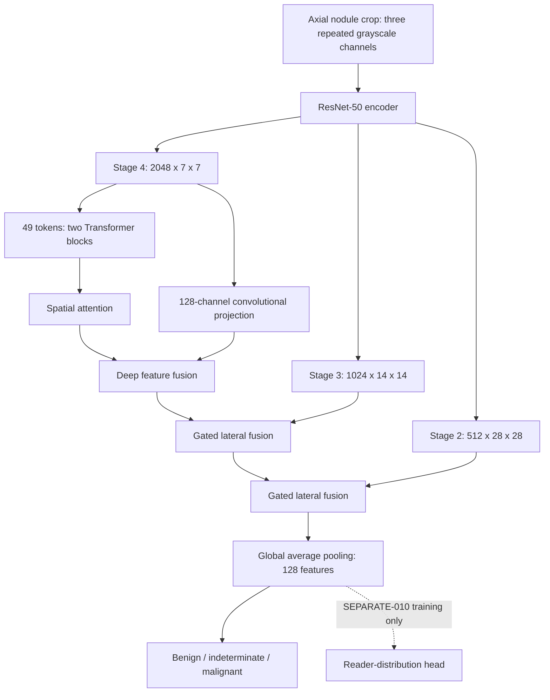

# GLADS-CT

**Gated Lung-Nodule Assessment with Disagreement-Aware Supervision in Computed Tomography**

[](LICENSE)
[](#recorded-research-environment)
[](#recorded-research-environment)
[](#dataset-and-study-design)

We study how pretrained representations and radiologist disagreement shape three-class lung-nodule assessment. GLADS-CT combines a ResNet-50 encoder, Transformer attention, spatial weighting and hierarchical gated fusion. We compare initialization and supervision under a shared training protocol, patient-separated cohorts and matched random seeds.

Our repository brings together the R50 implementation, documented experimental settings, per-seed results, checkpoint identities and a lightweight evidence verifier. We organize these materials so researchers can inspect the method, trace our reported findings and build on a clearly specified experimental foundation.

**Explore:** [Method](#method) · [Data](#dataset-and-study-design) · [Results](#experimental-results) · [Quick start](#quick-start) · [Source guide](research/r50-2026-10-22/SOURCE-GUIDE.md) · [Citation](#citation)

## Research focus

We address three connected questions:

1. How do random, ImageNet and RadImageNet initialization affect assessment under the same architecture and input recipe?
2. How does incorporating reader distributions change aggregate performance and class-specific behavior across matched seeds?
3. How does an expanded training cohort with scheduled axial views compare with our original representative-slice cohort?

We use patient-separated evaluation, training-only class weights, validation-based checkpoint selection and recorded initialization streams throughout these comparisons. We report every matched seed rather than choosing the strongest seed.

## Method

### Feature hierarchy

We use a 50-layer residual network (ResNet-50) to extract features at three spatial resolutions. The deepest features produce 49 tokens, processed by two Transformer blocks with four attention heads and a 128-dimensional embedding. Spatial attention weights these features before deep fusion. Two gated lateral fusion stages integrate intermediate convolutional features, followed by global average pooling and a three-class assessment head.



Our architecture operates on axial image inputs. In the expanded setting, we sample one scheduled view per nodule per epoch; validation uses a fixed representative image. Readers can inspect the exact [model](research/r50-2026-10-22/historical-replication/src/consendxformer/performance_v2/model.py), [input adapter](research/r50-2026-10-22/historical-replication/src/consendxformer/performance_v2/input_adapter.py) and [training runner](research/r50-2026-10-22/historical-replication/src/consendxformer/performance_v2/training_runner.py).

### Supervision

We retain the executed objective names to make the source and result records easy to reconcile.

| Objective | Training target and reduction |
| --- | --- |
| **HARD** | Class-weighted categorical cross-entropy on the discrete assessment label. |
| **LEGACY** | Entropy-dependent mixing of the hard target and reader distribution, normalized by total weighted target mass. |
| **SHARED-010** | HARD plus reader-distribution cross-entropy on the shared output, with coefficient 0.1. |
| **SEPARATE-010** | HARD plus reader-distribution cross-entropy on a separate output head, with coefficient 0.1. |

For LEGACY, we form the target as `t = (1 - u) * one_hot(y) + u * q`, where `q` is the three-class reader distribution and `u` is its normalized entropy. Single-reader cases have `u = 0`, so their targets remain one-hot. HARD uses no reader-distribution loss. Ordinal and attention-alignment loss coefficients are zero in these experiments; spatial attention remains part of the architecture.

We distinguish **indeterminate assessment**, a label category, from **inter-reader disagreement**, a property of the annotations. A nodule can be unanimously rated indeterminate. See our [objective implementation](research/r50-2026-10-22/historical-replication/src/consendxformer/performance_v2/objectives.py) for exact batch reductions.

## Dataset and study design

We use the public [Lung Image Database Consortium and Image Database Resource Initiative (LIDC-IDRI) collection](https://www.cancerimagingarchive.net/collection/lidc-idri/). Our labels represent radiologist-derived assessment categories: benign below a mean rating of 2.5, indeterminate at exactly 3, and malignant above 3.5. We exclude other boundary means under the frozen eligibility rule.

| Cohort | Patients | Nodules | Available axial views | Role |
| --- | ---: | ---: | ---: | --- |
| Original TRAIN | 437 | 807 | 807 representatives | Initialization and supervision comparisons |
| Expanded TRAIN | 529 | 1,297 | 4,273 | Matched HARD/LEGACY data-and-view extension |
| Validation | 84 | 143 | 143 representatives | Stopping, model selection and development |
| Historical TEST | 99 | 183 | 183 representatives | Earlier seed-42 initialization evaluation |

We preserve patient assignments across the two training designs and keep validation/test membership and labels fixed. The expanded training cohort retains all 807 original nodules and adds 490 single-reader nodules from training patients. We give nodules equal exposure through frozen within-seed view schedules and compute class weights from nodule counts, not view counts.

Our cached inputs are 64 x 64 float32 axial crops. We resize them to 224 x 224 with antialiased bilinear interpolation, replicate grayscale into three channels and apply the common ImageNet normalization. Training augmentation comprises horizontal/vertical flips, rotation within 10 degrees and translation within 8% per axis. The loader's conditional division by 255 applies only when the crop maximum exceeds 1; it was inactive in the inspected normalized crops.

We document counts, label rules, preprocessing and protocol settings in [SCIENTIFIC-PROTOCOL.json](research/r50-2026-10-22/protocols/SCIENTIFIC-PROTOCOL.json).

## Experimental results

### Initialization under a common recipe

We compare all three initializations at seed 42 on the original cohort. RadImageNet/HARD is our provisional validation-nominated configuration. We preserve that nomination independently of subsequent TEST findings.

| Initialization | Validation Macro-F1 (%) | Historical TEST accuracy (%) | Historical TEST Macro-F1 (%) |
| --- | ---: | ---: | ---: |
| Random | 66.45 | 63.93 | 64.89 |
| ImageNet | 69.55 | 69.40 | 70.48 |
| RadImageNet | **70.49** | 66.67 | 67.25 |

We report the earlier TEST evaluation explicitly as historically exposed. The complete [initialization record](research/r50-2026-10-22/results/original807-initialization.json) includes class metrics, cross-entropy and selected checkpoint hashes.

### Matched three-seed supervision comparison

We evaluate HARD and LEGACY at seeds 42, 43 and 44. Values below are validation Macro-F1, reported as **mean +/- sample standard deviation** in percentage points.

| Training design | HARD (%) | LEGACY (%) |
| --- | ---: | ---: |
| Original 807-nodule cohort | 70.00 +/- 1.01 | 70.34 +/- 1.82 |
| Expanded 1,297-nodule cohort | 68.99 +/- 1.93 | 66.27 +/- 1.40 |

The original cohort retains the higher Macro-F1 in all six matched original-versus-expanded pairs. We therefore interpret the expansion as a combined change in membership, annotation support, views, class weights and update count, rather than attributing its results to view sampling alone.

On the expanded cohort, HARD emphasizes indeterminate recognition, while LEGACY raises mean malignant recall from 80.83% to 88.33%. Mean indeterminate recall is 59.65% for HARD and 48.25% for LEGACY. These class trade-offs are central to our analysis of reader-aware objectives.

<details>
<summary><strong>All six expanded-cohort validation results</strong></summary>

| Run | Selected / stopped epoch | Accuracy (%) | Macro-F1 (%) | Diagnostic CE |
| --- | ---: | ---: | ---: | ---: |
| HARD-42 | 6 / 21 | 72.73 | 69.91 | 0.670 |
| LEGACY-42 | 6 / 21 | 72.03 | 67.53 | 0.695 |
| HARD-43 | 34 / 49 | 70.63 | 70.30 | 0.693 |
| LEGACY-43 | 11 / 26 | 67.13 | 66.52 | 0.696 |
| HARD-44 | 3 / 20 | 65.73 | 66.77 | 0.761 |
| LEGACY-44 | 12 / 27 | 64.34 | 64.76 | 0.698 |

CE denotes unweighted diagnostic cross-entropy against hard labels. We provide exact precision, recall, F1, confusion matrices, runtime records and checkpoint hashes in the [expanded result files](research/r50-2026-10-22/results/expanded1297/). Original per-seed outcomes are available in our [original-cohort replication record](research/r50-2026-10-22/results/original807-replication.json).

</details>

### Exploratory validation ensembles

We also study the class trade-offs available through six-model logit averaging with fitted weights and class offsets.

| Configuration | Accuracy (%) | Macro-F1 (%) | Benign F1 (%) | Indeterminate F1 (%) | Malignant F1 (%) |
| --- | ---: | ---: | ---: | ---: | ---: |
| D: accuracy-focused | **77.62** | **73.99** | 85.51 | 53.13 | 83.33 |
| E: indeterminate-focused comparison | 74.83 | 73.46 | 80.65 | 56.41 | 83.33 |

Configuration D correctly classifies 111 of 143 validation nodules. We fitted and assessed these ensemble configurations using the same validation labels, so we report them as **exploratory development-set results**, separately from individual-model and historical TEST performance. Exact weights, offsets and matrices are available in our [ensemble record](research/r50-2026-10-22/results/exploratory-validation-ensembles.json).

### Evaluation scope

We use validation Macro-F1 for checkpoint selection, with unweighted diagnostic CE and earliest epoch as tie-breakers. Three matched seeds describe training variability. We reserve claims about independent generalization, isolated component effects, calibrated probabilities and clinical utility for corresponding validation studies. Cross-paper comparisons require attention to cohort, label, split and selection differences.

## Quick start

### 1. Obtain the repository

```bash
git clone https://github.com/FawadKarimi/GLADS-CT.git
cd GLADS-CT
git rev-parse HEAD
```

Record the commit when citing or comparing this release.

### 2. Verify the public snapshot

```bash
python tools/verify_publication_snapshot.py
```

Our verifier uses only the Python standard library. It checks released file hashes, historical source bindings and saved confusion-matrix arithmetic, including per-class metrics. It parses source syntax without importing the research modules. It does not construct models, download artifacts, read medical images or run training/inference. A successful run prints a JSON report with `"status": "PASS"`.

### 3. Inspect the implementation and protocol

Start with the [source guide](research/r50-2026-10-22/SOURCE-GUIDE.md), [scientific protocol](research/r50-2026-10-22/protocols/SCIENTIFIC-PROTOCOL.json) and [reproducibility guide](research/r50-2026-10-22/REPRODUCIBILITY.md). We preserve the distinction between the locked original R50 candidate and the recovered expanded runner. The latter retains its original site-specific paths and should be read together with its provenance record.

The root `pyproject.toml`, `src/`, `configs/` and `scripts/` belong to our earlier baseline infrastructure. We keep them for continuity; the R50 paper implementation is under `research/r50-2026-10-22/`. Installing the root package does not recreate the R50 training environment.

## Training protocol

| Setting | Recorded value |
| --- | --- |
| Initialization for supervision runs | Original verified RadImageNet backbone |
| Backbone import | 318 entries, including all 53 supplied BatchNorm counters |
| Matched seeds | 42, 43, 44 |
| Batch size and precision | 16 nodules; 32-bit floating point (FP32) |
| Optimizer | AdamW; betas (0.9, 0.999), epsilon 1e-8 |
| Learning rates | 1e-4 for backbone/features; 1e-3 for heads |
| Weight decay | 1e-4; excluding biases, normalization parameters and positional embeddings |
| Schedule | Five-epoch warm-up followed by cosine decay through epoch 100 |
| Gradient-norm clipping | 1.0 |
| Stopping | 20-epoch minimum, 100-epoch maximum, patience 15 |
| Checkpoint selection | Validation Macro-F1, then diagnostic CE, then earliest epoch |
| Training exposure | One view per nodule per epoch; matched within-seed HARD/LEGACY schedules |

AdamW denotes adaptive moment estimation with decoupled weight decay. Our initialization design uses separate recorded random-number streams for the backbone, shared modules, heads and training behavior. Supervision runs begin with the original pretrained backbone rather than a previously fine-tuned HARD checkpoint.

## Recorded research environment

| Component | Recorded environment |
| --- | --- |
| Python | 3.10.17 |
| PyTorch | 2.3.0+cu121 |
| torchvision | 0.18.0+cu121 |
| Compute | Shared NVIDIA RTX 2080 Ti |

These entries describe our recorded execution environment. The read-only verifier requires no PyTorch installation. For a new training environment, use the source, artifact and data bindings described in the reproducibility guide rather than treating the historical root dependency files as an R50 environment lock.

## Repository organization

```text
GLADS-CT/
├── README.md                         # Main project entry point
├── CITATION.cff                      # Software citation metadata
├── LICENSE                           # MIT license for original code
├── THIRD_PARTY_NOTICES.md             # Data, weights and dependency terms
├── tools/
│   └── verify_publication_snapshot.py # Read-only source/metric verifier
├── research/r50-2026-10-22/
│   ├── SOURCE-GUIDE.md                # R50 implementation navigation
│   ├── historical-replication/        # Byte-preserved source and test snapshot
│   ├── recovered-expanded/            # Recovered expansion and ensemble scripts
│   ├── protocols/                     # Scientific protocol documentation
│   ├── results/                       # Per-seed and aggregate result records
│   ├── provenance/                    # Source identity and historical lock
│   ├── REPRODUCIBILITY.md              # Artifact requirements and evidence scope
│   └── SHA256-LEDGER.json              # Public snapshot checksum ledger
├── docs/history/                      # Preserved earlier documentation
└── src/, configs/, scripts/, tests/   # Earlier baseline infrastructure
```

## Data, checkpoints and artifact access

We distribute source code and aggregate evidence. We retain selected checkpoint identities in the result files, and we link the official [LIDC-IDRI collection](https://www.cancerimagingarchive.net/collection/lidc-idri/) and [RadImageNet project](https://github.com/BMEII-AI/RadImageNet) for their respective resources.

Research images, pretrained weights, trained checkpoint bodies, patient-level membership/view schedules and private execution records are maintained separately. Reproducing exact inputs requires the corresponding authenticated artifacts. Our [provenance record](research/r50-2026-10-22/provenance/SOURCE-PROVENANCE.json) distinguishes the verified historical source snapshot from recovered expanded-stage material. We retain the common normalization recipe and document its difference from RadImageNet's recommended preprocessing, together with unresolved pretraining overlap information, in the reproducibility guide.

## Citation

Please use [CITATION.cff](CITATION.cff) or GitHub's **Cite this repository** feature and identify the exact commit used. For the initial public R50 source-and-evidence snapshot, we provide this software citation:

```bibtex
@software{karimi2026gladsct,
  author  = {Karimi, Mohammad Fawad},
  title   = {GLADS-CT research code and evidence snapshot},
  version = {2026.10.22},
  year    = {2026},
  url     = {https://github.com/FawadKarimi/GLADS-CT/tree/3cf719e932bc882ecf9045c6500c6a8738a1dd66}
}
```

We will add the publication citation when its bibliographic details are finalized. When using LIDC-IDRI, RadImageNet or other third-party resources, please cite their original publications as well.

## License and acknowledgments

We release our original code under the [MIT License](LICENSE). Datasets, pretrained weights, third-party source and dependencies retain their own terms; see [THIRD_PARTY_NOTICES.md](THIRD_PARTY_NOTICES.md).

We acknowledge the LIDC-IDRI contributors, The Cancer Imaging Archive, the RadImageNet team and the developers of PyTorch and torchvision. We thank Universitas Syiah Kuala and our collaborators for supporting this research. Data reuse should follow the collection terms and applicable institutional ethics procedures.

## Questions and contributions

We welcome reproducibility questions, implementation clarifications and focused contributions through [GitHub Issues](https://github.com/FawadKarimi/GLADS-CT/issues) and pull requests. Please include the relevant commit, source path and minimal description. Keep medical images, identifying metadata, credentials and private artifact links out of public issues. We ask contributors to preserve the frozen result records and propose changes separately from historical source snapshots.
